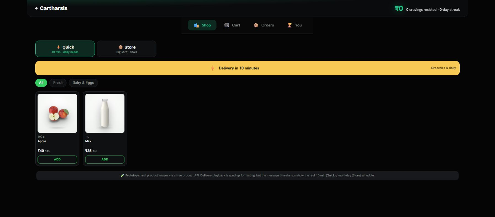

# Cartharsis — Shopping Journey Simulator

Prototype a shopping journey with simulated checkout, delivery and unboxing without charging money.

**Built by Himanshu Chauhan** · [GitHub](https://github.com/himanshuc2406) · Contact: himanshuc2406@gmail.com

## Project walkthrough




## What the code implements

- Offer Quick and Store shopping modes with product discovery, cart and simulated checkout.
- Model delivery stages, a conversational feed and a timed unboxing flow.
- Track simulated orders and money not spent in browser storage.
- Use cached catalog adapters with optional externally configured product-data access.

## Technical stack

Python · Flask · JavaScript · CSS · localStorage · product catalog APIs

## Run locally

```bash
python -m venv .venv
# Activate .venv for your operating system.
pip install -r requirements.txt
python app.py
```

Open **http://127.0.0.1:5000**. Never commit your `.env`, API keys, OAuth credentials or runtime databases. Blank configuration examples are provided where needed.

## Verification

Python syntax checked; interface screenshot captured from the running local copy. No paid API or real purchase flow was exercised.

## Scope and limitations

This is a product/UX prototype, not a clinical intervention or validated savings tool. Checkout and delivery are simulations. Displayed conversions, review counts and counters can be demo values. No production authentication/database/payment integration is included.

## Repository structure

- `.env.example`
- `.gitignore`
- `app.py`
- `cartharsis.html`
- `docs /`
- `README.md`
- `requirements.txt`
- `run.bat`
- `static /`
- `templates /`
